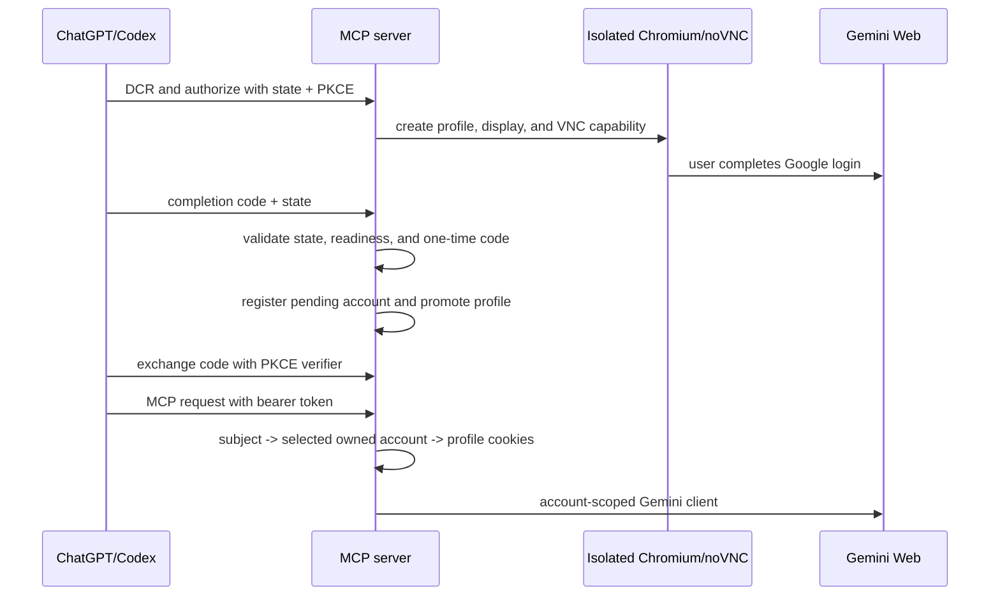

# Authentication architecture

Dynamic registration creates a public PKCE client. It does not create a Google
credential and does not log the caller into Google. Each authorization creates a
distinct subject and account alias. A subject with several ready accounts must
select one explicitly through `gemini_select_account`.

The browser URL contains only the short-lived noVNC capability. OAuth code,
state, and PKCE verifier remain in their respective OAuth flow and are never
used as a VNC token.
