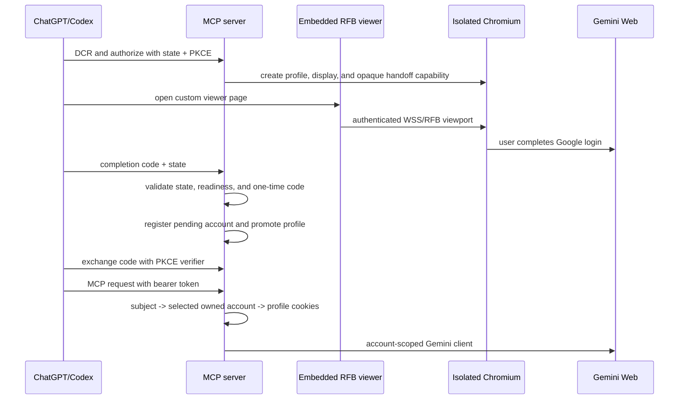

# Authentication architecture

Dynamic registration creates a public PKCE client. It does not create a Google
credential and does not log the caller into Google. Each authorization creates a
distinct subject and account alias. A subject with several ready accounts must
select one explicitly through `gemini_select_account`.

The browser URL contains only the short-lived viewer capability. OAuth code,
state, and PKCE verifier remain in their respective OAuth flow and are never
used as an RFB token. The viewer is our own page and does not iframe Google or
the Linux desktop; noVNC's RFB client is used only as a protocol library.

The same page works as a top-level URL or as an iframe when its explicit
`GEMINI_VIEWER_FRAME_ANCESTORS` policy allows the embedding origin. The viewer
uses an account-bound handoff, polls only redacted status, and never receives
Gemini cookies, passwords, clipboard contents, or screenshots.
